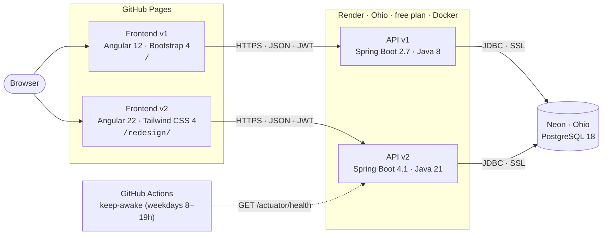
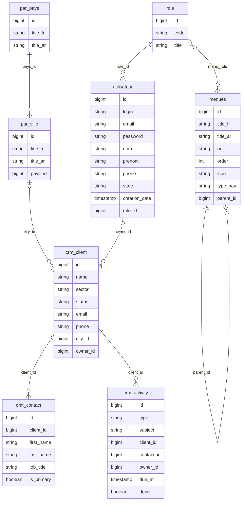
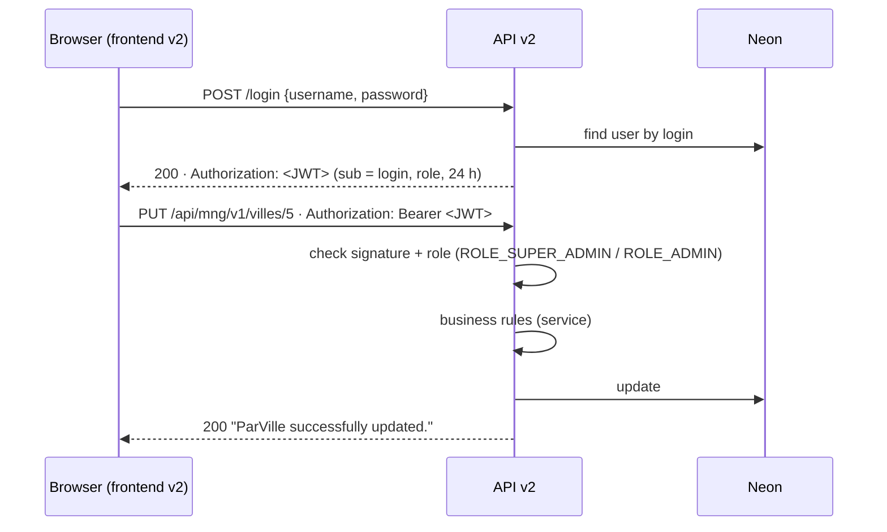

# SmartClientManagement-FrontEnd
### _v.0.1_

This is the master branch of SmartClientManagement frontEnd.
This document decribes the steps to follow to build the project in a Debian/Ubuntu architecture or github page.

## For login
Url: https://devopsachrafou.github.io/smartClientManagement-FrontEnd/
 
```
login :
a.admin
  
Password : 
123456789
``` 

## Two versions
| Version | Address | Stack |
|---|---|---|
| Original | https://devopsachrafou.github.io/smartClientManagement-FrontEnd/ | Angular 12, Bootstrap 4 (this folder, built to `docs/`) |
| Redesign | https://devopsachrafou.github.io/smartClientManagement-FrontEnd/redesign/ | Angular 22 (signals, zoneless, standalone), Tailwind CSS 4 (`redesign-app/`, built to `docs/redesign/`) |

Both use the same API (Spring Boot on Render + PostgreSQL on Neon, free plans). The backend sleeps after 15 minutes without traffic: the first request can take about a minute, and the redesign shows this on the login page.

Redesign highlights: dashboard with key figures and charts, users / roles / menus / countries / cities management, sidebar built from the role's menus, French and Arabic (RTL), light and dark mode, mobile layout, accessible forms and dialogs.

Build the redesign (Node 22):
```
$ cd redesign-app
$ npm install
$ npx ng build      # writes ../docs/redesign
```

## Architecture

SmartClientManagement exists in two versions, old and new, on both sides. Each frontend calls its own API; both APIs share the same database.



| Part | Hosted on | Address |
|---|---|---|
| Frontend v1 | GitHub Pages | https://devopsachrafou.github.io/smartClientManagement-FrontEnd/ |
| Frontend v2 | GitHub Pages | https://devopsachrafou.github.io/smartClientManagement-FrontEnd/redesign/ |
| API v1 | Render | https://smartclientmanagement-backend-nqly.onrender.com |
| API v2 | Render | https://smartclientmanagement-api-v2.onrender.com (docs: `/swagger-ui.html`) |
| Database | Neon (AWS us-east-2) | PostgreSQL 18, shared by both APIs |

| Repository | Content |
|---|---|
| [smartClientManagement-FrontEnd](https://github.com/DevOpsAchrafOu/smartClientManagement-FrontEnd) | `src/` frontend v1 · `redesign-app/` frontend v2 · `docs/` published site · `.github/workflows/keep-awake.yml` |
| smartClientManagement-BackEnd (private) | repository root: API v1 · `backend-v2/`: API v2 · `render.yaml`: both Render services |

### Frontend

| | v1 (original) | v2 (redesign) |
|---|---|---|
| Source → output | `src/` → `docs/` | `redesign-app/` → `docs/redesign/` |
| Framework | Angular 12.0.5 (NgModules, zone.js) | Angular 22.3.0 (standalone components, signals, zoneless) |
| Language | TypeScript 4.2.4, RxJS 6.6.7 | TypeScript 6.0.3, RxJS 7.8.2 |
| Styling | Bootstrap 4.6.2, jQuery 3.6.3, Select2 | Tailwind CSS 4.3.5, inline SVG icons |
| UI | ng-bootstrap 10, ngx-toastr 14.3, SweetAlert2 11.7 | Own dialogs, toasts and confirmations |
| Languages | French / Arabic (ngx-translate 14) | French / Arabic with right-to-left layout (own i18n service) |
| Theme | Light | Light and dark |
| Routing | Path URLs | Hash URLs (work on GitHub Pages), view transitions, lazy-loaded pages |
| Build | Node 16 | Node 22, Angular CLI 22.3 |
| Calls | API v1 | API v2 |
| CRM | – | Clients and contacts, activities and tasks, CRM dashboard (`/crm`) |

Frontend v2 layout:

```
redesign-app/src/app
├── core/    api.ts (REST calls) · auth.ts (session, guard, JWT interceptor) · i18n.ts · theme.ts
│            server.ts (wakes the free backend) · toast.ts · config.ts (API address)
├── ui/      icon · modal · overlays (toasts + confirmation) · states (loading / error / empty)
└── pages/   login · shell (sidebar + top bar) · dashboard · users · roles · menus · countries · cities
```

### Backend

| | API v1 | API v2 |
|---|---|---|
| Folder | repository root | `backend-v2/` |
| Java | 8 | 21 (Eclipse Temurin) |
| Spring Boot / Spring | 2.7.10 / 5.3.26 | 4.1.2 / 7.0.10 |
| Web server | Tomcat 9.0.73 | Tomcat 11.0.27 |
| Persistence | Hibernate 5.6.15, `ddl-auto=update` | Hibernate 7.4.13, `validate` + Flyway 12.4.0 |
| Security | Spring Security 5.7.7, java-jwt 3.4.1 (HS512) | Spring Security 7.1.2 resource server, Nimbus JOSE 10.9 (HS256) |
| Sessions | One stored token per account | Stateless JWT, several sessions at once |
| Access | Any signed-in user can change anything | Reads for signed-in users, changes for admins only |
| JSON | Jackson 2 | Jackson 3.1 |
| Errors | Mixed | RFC 9457 problem details with a `message` field |
| API docs | Springfox 2.8 (Swagger 2) | springdoc 3.0 (OpenAPI 3) |
| Monitoring | – | Actuator `/actuator/health` |
| Tests | – | Integration tests on PostgreSQL 18 (Testcontainers) |
| Driver / pool | PostgreSQL 42.7.4, HikariCP | PostgreSQL 42.7.14, HikariCP 7.0.2 |

API v2 layout (one package per feature; each request goes Controller → Service → Repository → Entity):

```
ma.mang.be.api
├── config    SecurityConfig · AppProperties · OpenApiConfig · DatabaseUrl (accepts the Neon address as is)
├── security  AuthController (/login) · JwtService · AccountDetailsService · CurrentUser
├── common    ApiException · GlobalExceptionHandler · Messages
├── user · role · menu · geo   entity, repository, DTO, service (rules, transactions), controller
└── demo      DemoDataInitializer (demo data on an empty database)
```

Endpoints (same in v1 and v2), under `/api/mng/v1`:

| Resource | Endpoints |
|---|---|
| Sign in | `POST /login` (token in the `Authorization` response header) |
| Public | `GET /public/about` · `GET /public/logout` |
| Users | `GET /utilisateurs` · `/utilisateurs/me` · `/utilisateurs/{id}` · `POST /signup` · `PUT /utilisateurs/{id}` · `PUT /utilisateurs/passwords` · `DELETE /utilisateurs/{id}` |
| Roles | `GET /roles` · `/roles/{id}` · `/roles/utilisateur/count/{id}` · `POST /roles` · `PUT /roles/{id}` · `DELETE /roles/{id}` |
| Menus | `GET /menus` · `/menus/role` · `/menus/parent` · `/menus/userConnected` · `/menus/{id}` · `POST` · `PUT` · `DELETE` |
| Countries / cities | `/pays` · `/pays/{id}` · `/villes` · `/villes/{id}` · `/villes/pays/{id}` (full CRUD) |
| **CRM (v2 only)** · clients | `GET /crm/clients?q=&status=&sort=&page=&size=` · `/crm/clients/counts` · `/crm/clients/{id}` · `POST` · `PUT` · `DELETE` (admins) |
| **CRM** · contacts | `GET/POST /crm/clients/{id}/contacts` · `PUT/DELETE /crm/contacts/{id}` (one primary contact per client) |
| **CRM** · activities | `GET /crm/activities?view=OPEN\|TODAY\|LATE\|DONE\|ALL&mine=&clientId=&type=&q=` · `POST` · `PUT /{id}` · `PUT /{id}/done` · `DELETE` |
| **CRM** · dashboard | `GET /crm/dashboard` (clients per status, conversion rate, open / late / today tasks, per sector, city and owner) |

### Database



- Passwords are stored as BCrypt hashes. The `token` column of `utilisateur` is used by API v1 only.
- API v2 manages the schema with Flyway (`backend-v2/src/main/resources/db/migration`): `V1` is the schema API v1 created, recorded as the baseline on Neon; the only table it added is `flyway_schema_history`.
- CRM tables (`crm_client`, `crm_contact`, `crm_activity`) come from Flyway `V2` and `V3` and are used by API v2 only. Links to cities and users are cleared (not blocked) if API v1 deletes them.
- Demo data: 3 users, 4 roles, 8 menus, 5 countries, 23 cities; CRM: 8 fictional companies, their contacts and 15 activities. Demo account: `a.admin` / `123456789`.

### Security



- Admins only for changes. Only a super admin manages super admins; the last super admin cannot be deleted or demoted.
- The demo account `a.admin` cannot be deleted, lose its role or change its password.
- CORS (API v2): `https://devopsachrafou.github.io` and `http://localhost:*` only.
- Secrets live in Render environment variables (`DB_URL`, `DB_USERNAME`, `DB_PASSWORD`, `JWT_SECRET`), never in the code.

### Deployment

| Step | How |
|---|---|
| Frontend | `ng build` writes `docs/` (v1) or `docs/redesign/` (v2) → merge to `main` → GitHub Pages publishes |
| APIs | Merge to `main` → Render builds the Docker image (Maven, then a Java 8 or 21 runtime) → health check → live |
| Build filters | API v1 ignores `backend-v2/**`; API v2 only reacts to `backend-v2/` |
| Keep awake | GitHub Actions pings API v2 every 10 min, weekdays 08:00–19:00 Morocco time (free Render services sleep after 15 min; 750 free hours a month for the workspace) |
| Local (API v2) | `docker compose up -d` (PostgreSQL) then `./mvnw spring-boot:run` |

## Features
- Login and logout
- User management
- Role management
- Menu management : Create, View, Update
- Ville management : Create, View, Update
- Pays management : Create, View, Update

## Technologies used
- pipe
- Custom Validators 
- Service, Component, Interface
- Combined Add/Edit in same Modal(Popup)
- Interceptors (authentication, authorization)
- Error handling (code status)
- Loading spinner

(v.10)
// Internationalization (i18n)

## Tech
SmartClientManagement frontEnd uses a number of open source projects to work properly:
- [Angular CLI v12.0.0]
- [Node.js v16.15.1]
- [npm v8]

## Setup & Getting started

1. Install [NodeJS](http://nodejs.org/) (If you done have)

2. If you have not installed angular yet,

#Install angular globally

```
$ npm install -g @angular/cli@12.0.0-rc.2
```

3. Clone porjet FrontEnd

```
$ ng clone https://github.com/DevOpsAchrafOu/smartClientManagement-FrontEnd
```

4. navigate to smartClientManagement-FrontEnd/ directory.

```   
$ cd smartClientManagement-FrontEnd 
```

5. then install dependencies

```
$ npm install
```

6. Serve the application using (run dev)


6. Getting started

Run `ng serve` for a dev server.
 
```
$ ng serve
```

#Navigate to `http://localhost:4001/`. The app will automatically reload if you change any of the source files.

### Building the project and Deploy Angular App to github page

1. Run `ng build` to build the project.
```
$ ng build --output-path docs  --prod --base-href './'
```
 The build artifacts will be stored in the `docs/` directory. Use the `--prod` flag for a production build and Use the `--output-path` for a change path.

2. create .htaccess file & add variables:

- create file `Nouveau Document texte.txt` & re-name it to `.htaccess`
- set your desired variable value
```
<IfModule mod_rewrite.c>
  RewriteEngine On

  RewriteCond %{DOCUMENT_ROOT}%{REQUEST_URI} -f [OR]
  RewriteCond %{DOCUMENT_ROOT}%{REQUEST_URI} -d
  RewriteRule ^ - [L]
  RewriteRule ^ /index.html
  RewriteRule ^ /404.html
</IfModule>
```
3. After copy/paste .htaccess file in build folder(docs)

## Deploy smartClientManagement-FrontEnd

# Deploy Angular smartClientManagement-FrontEnd App to github page

1. After copy/paste .htaccess file in build folder(admin)

2. Watch this video : https://www.youtube.com/watch?v=aT3yBPxkH7s&t=36s


### Building the project and Deploy Angular App to server Debian/Ubuntu 

### Building the project

1. Run `ng build` to build the project.
```
$ ng build --prod --base-href '/smartClientManagement-FrontEnd/’
```
 The build artifacts will be stored in the `dist/` directory. Use the `--prod` flag for a production build.
 

2. create .htaccess file & add variables:

- create file `Nouveau Document texte.txt` & re-name it to `.htaccess`
- set your desired variable value
```
<IfModule mod_rewrite.c>
    RewriteEngine on
    RewriteCond %{REQUEST_FILENAME} -s [OR]
    RewriteCond %{REQUEST_FILENAME} -l [OR]
    RewriteCond %{REQUEST_FILENAME} -d
    RewriteRule ^.*$ - [NC,L]
    RewriteRule ^(.*) /smartClientManagement-FrontEnd/index.html [NC,L]
</IfModule>
```
3. After copy/paste .htaccess file in build folder(smartClientManagement-FrontEnd)

## Deploy smartClientManagement-FrontEnd

# Deploy Angular smartClientManagement-FrontEnd App to Apache Server

!. Install Apache2:
Install from here: http://httpd.apache.org/docs/current/install.html

2. Copy the dist/smartClientManagement-FrontEnd folder in /var/www/ folder.


## License

SmartClientManagement - copyright - 2023-2024
