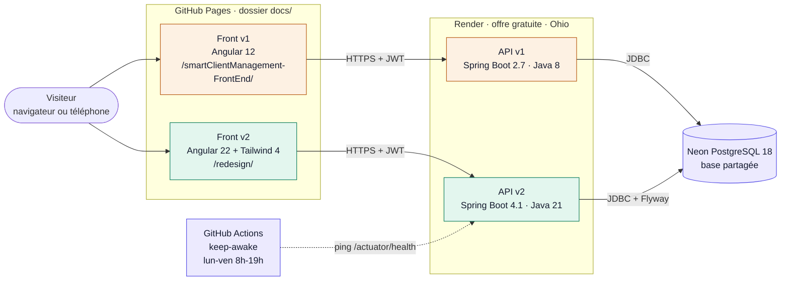
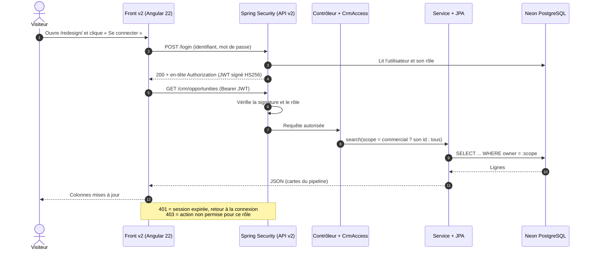
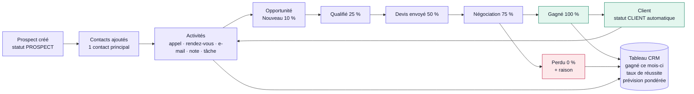
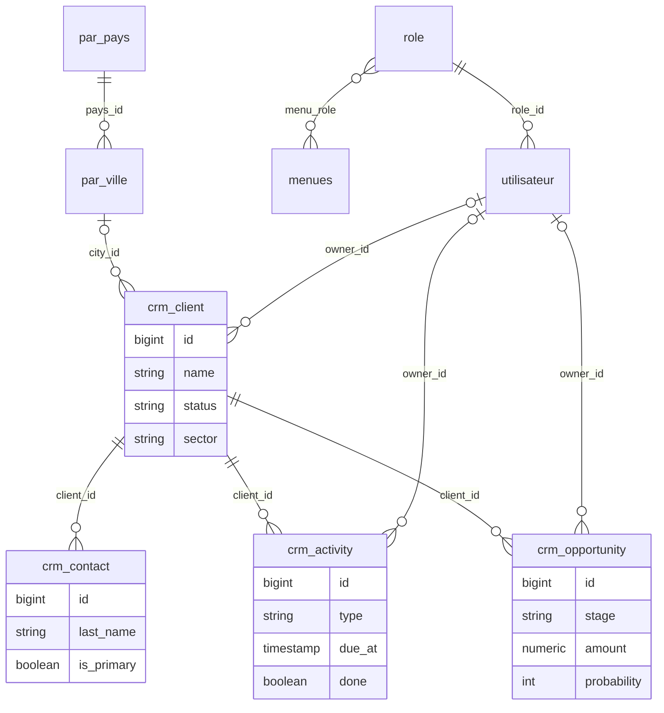
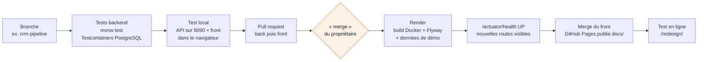

# Architecture et workflow de bout en bout

Deux versions de l’application tournent côte à côte : l’ancienne (**v1**) reste intacte, la nouvelle (**v2**) ajoute la refonte et le CRM. Elles partagent la même base de données. Ce document suit une requête depuis le navigateur jusqu’à la base, puis le chemin d’une modification depuis le code jusqu’à la mise en ligne.

> Voir aussi : [Le workflow métier du CRM](WORKFLOW-CRM.md)

## Vue d’ensemble : qui parle à qui

Le navigateur charge le front depuis GitHub Pages, puis appelle l’API sur Render. Chaque front a son API, et les deux API lisent et écrivent dans la même base Neon.

## Workflow utilisateur : du clic jusqu’à la base de données

Le parcours d’un visiteur sur la nouvelle version, dans l’ordre :

1. **Ouvrir le site** : GitHub Pages sert l’application Angular. Les URL utilisent un # (ex. `#/crm`), donc aucune configuration serveur n’est nécessaire.
2. **Réveiller le serveur** : sur l’offre gratuite, Render endort l’API après 15 min sans trafic. La page de connexion la réveille et affiche « Serveur prêt ».
3. **Se connecter** : `POST /login` vérifie le mot de passe (BCrypt) et renvoie un jeton JWT dans l’en-tête `Authorization`.
4. **Charger le profil** : `/utilisateurs/me` et `/menus/userConnected` construisent la barre latérale. Les rôles CRM arrivent directement sur `#/crm`.
5. **Appeler l’API** : chaque requête porte `Bearer <jeton>`. Spring Security vérifie la signature et le rôle, puis `CrmAccess` limite ce qu’un commercial voit.
6. **Lire et écrire** : le service passe par JPA / Hibernate jusqu’à Neon. La réponse JSON met à jour les signaux Angular, et l’écran se rafraîchit.

## Workflow métier : la vie d’un client dans le CRM

Un prospect devient client en passant par le pipeline. Les activités suivent chaque étape, et le tableau de bord résume le tout. Le détail est dans [WORKFLOW-CRM.md](WORKFLOW-CRM.md).

| Rôle | Code | Ce qu’il peut faire dans le CRM | Compte de démo |
|---|---|---|---|
| Super Admin · Administrateur | `ROLE_SUPER_ADMIN` · `ROLE_ADMIN` | Tout, y compris l’administration (utilisateurs, rôles, menus, pays, villes) | `a.admin` |
| Manager commercial | `ROLE_MANAGER` | Tout le CRM, choisit le responsable, supprime les clients | `y.benali` |
| Commercial | `ROLE_SALES` | Seulement ses clients, contacts, activités et opportunités | `s.mansouri` |
| Lecture seule | `ROLE_VIEWER` | Voit tout le CRM, ne modifie rien (403) | `l.bouzid` |
| Utilisateur | `ROLE_USER` | Tout le CRM, sans supprimer de client | `s.ahmed` |

## À l’intérieur de chaque version

**v2 · Front (`redesign-app/`)**
- `core/` : auth (JWT, intercepteur 401), api, crm (types, appels, droits `CrmRights`), i18n FR/AR, thème
- `pages/` : connexion, shell (menu + barre du haut), administration, `crm/` (tableau, clients, fiche, pipeline, activités)
- `ui/` : composants réutilisables (modales, formulaires CRM, cartes du pipeline, icônes)
- Composants autonomes, signaux, sans zone.js, routes en #, pages CRM chargées à la demande

**v2 · API (`backend-v2/` du dépôt backend)**
- `config/` : SecurityConfig (règles par rôle), CORS, liens avec ou sans / final
- `security/` : JwtService (HS256 Nimbus), CurrentUser, comptes
- `crm/` : client, contact, activity, opportunity, dashboard, `CrmAccess` (portée par rôle)
- `demo/` : données de démo insérées une seule fois (ordre 1 → 4)
- `db/migration/` : Flyway V1 (base de départ) → V4 (opportunités)
- Erreurs au format ProblemDetail, documentation springdoc sur `/swagger-ui.html`

**v1 · Front et API d’origine**
- Front : Angular 12, Bootstrap, à la racine du site
- API : Spring Boot 2.7, Java 8, à la racine du dépôt backend
- Inchangés. Les nouvelles tables CRM ne les gênent pas : supprimer une ville ou un utilisateur vide simplement le lien

## Le modèle de données dans Neon

Les tables d’origine servent aux deux versions. Les tables `crm_*` viennent des migrations Flyway V2 à V4 et ne servent qu’à la v2.

## Workflow de développement : du code à la mise en ligne

Chaque modification suit le même chemin. Le backend est toujours mergé et déployé avant le front qui l’utilise.

## Les briques et leurs versions

| Brique | Version 1 | Version 2 | Hébergement |
|---|---|---|---|
| Front | Angular 12 · Node 16 | Angular 22 · Tailwind 4 · Node 22 | GitHub Pages (`docs/`) |
| API | Spring Boot 2.7 · Java 8 | Spring Boot 4.1.2 · Java 21 · Hibernate 7 | Render, offre gratuite, Ohio |
| Sécurité | JWT (filtre maison) | OAuth2 Resource Server, JWT HS256 sans état | – |
| Base de données | PostgreSQL 18 (partagée) | PostgreSQL 18 (partagée), schéma géré par Flyway 12 (V1 → V4) | Neon, AWS US East 2 |
| Tests | – | JUnit + Testcontainers (13 tests) | Local (Docker) |
| Anti-veille | – | Ping de l’API v2 en semaine, de 8 h à 19 h (heure du Maroc) | GitHub Actions |

Prévu plus tard : un assistant IA, ajouté à la fin, sur le front et le back de la v2.
