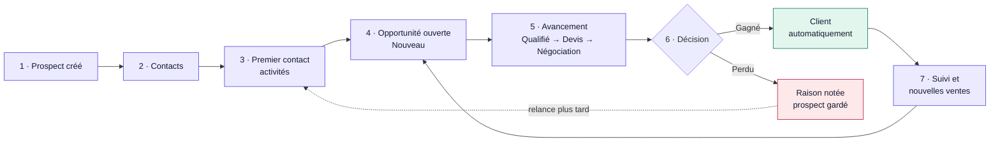
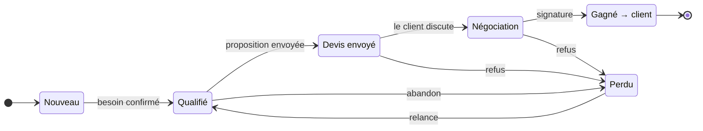

# Le workflow métier du CRM, du prospect au client fidèle

Ce qu’une équipe commerciale fait dans l’application (version 2, `/redesign/`), dans l’ordre : qui agit, sur quel écran, et ce que l’application fait automatiquement à chaque étape.

> Voir aussi : [Architecture et workflow de bout en bout](ARCHITECTURE.md) · [Explication en arabe](#شرح-بالعربية)

## Le cycle complet

Un prospect entre dans le CRM, on le contacte, on ouvre une opportunité qui avance d’étape en étape. Gagnée, elle fait du prospect un client, qu’on continue de suivre avec de nouvelles activités et de nouvelles opportunités.

## شرح بالعربية

**الفكرة:** شركة نتعرّف عليها، نتواصل معها، نقترح عليها بيعًا، ثم إمّا ننجح فتصبح **Client**، أو نخسر ونسجّل السبب. الكلمات بالفرنسية هي نفسها التي تظهر في التطبيق.

**المثال:** شركة **Rif Digital** في تطوان، والمندوبة التجارية (**Commercial**) هي سارة.

### 1. إنشاء الـ Prospect

سارة تسمع عن شركة **Rif Digital**، فتدخل إلى **Clients** ← **Nouveau client** وتسجّلها. تبدأ الشركة بالحالة **Prospect**، وتصبح سارة **Responsable** عنها تلقائيًا.

### 2. إضافة الـ Contacts

في **Fiche client** تضيف سارة ياسين العمراني (**Gérant**) وتجعله **Contact principal**.

### 3. أول تواصل: الـ Activités

- سارة تتصل بياسين، فتسجّل **Activité** من نوع **Appel**: «مكالمة تعارف».
- ثم تضيف **Tâche** بتاريخ **Échéance**: «عرض تجريبي يوم الخميس».
- إذا مرّ التاريخ ولم تُعلَّم المهمة **Fait**، تظهر بالأحمر: **En retard**.

### 4. فتح Opportunité

ياسين مهتمّ بشراء ترخيص لفريقه، فتنشئ سارة **Nouvelle opportunité**: «Licence équipe (10 postes)» بمبلغ **45.000 MAD**. تبدأ في المرحلة **Nouveau** باحتمال (**Probabilité**) **10 %**.

### 5. التقدّم في الـ Pipeline

كلما تقدّم البيع، تسحب سارة البطاقة إلى العمود التالي:

- **Qualifié (25 %)**: ياسين أكّد الحاجة والميزانية.
- **Devis envoyé (50 %)**: أرسلت له عرض السعر.
- **Négociation (75 %)**: يناقشان السعر والشروط.

الـ **Prévision pondérée** (المبلغ × الاحتمال) تُحسب تلقائيًا: في **Négociation** تكون 45.000 × 75 % = **33.750 MAD**.

### 6. القرار

- ✅ **Gagné**: ياسين وقّع، فتضع سارة البطاقة في عمود **Gagné**. الاحتمال يصبح **100 %** ويُسجَّل تاريخ الإغلاق، و**Rif Digital تتحوّل تلقائيًا من Prospect إلى Client**، ورقم **Gagné ce mois-ci** يزيد بـ 45.000 MAD.
- ❌ **Perdu**: لو رفض ياسين، تضعها سارة في **Perdu** وتكتب **Raison de la perte**، مثلًا «Trop cher». يمكن إعادة فتحها لاحقًا.

### 7. المتابعة وبيع جديد

**Rif Digital** أصبحت **Client**، لكن العمل لا يتوقف: سارة تتابع بـ **Activités** (مكالمة رضا، تجديد العقد). بعد مدة تفتح **Opportunité** جديدة، مثلًا «Formation de l’équipe»، فتعود الدورة من الخطوة 4.

### وماذا عن الـ Manager commercial؟

يوسف (المدير) يفتح **Tableau CRM** ويرى كل الفريق: **Pipeline ouvert**، و**Prévision pondérée**، و**Gagné ce mois-ci**، و**Taux de réussite**، والفرص **en retard**. ويستطيع تغيير الـ **Responsable**، أي إعطاء عميل أو فرصة لمندوب آخر.

**الخلاصة:** **Prospect** ← **Contacts** ← **Activités** ← **Opportunité** ← **Qualifié** ← **Devis envoyé** ← **Négociation** ← **Gagné** (يصبح **Client**) أو **Perdu** ← متابعة و**Opportunité** جديدة.

## Les 7 étapes du workflow

| # | Étape | Qui | Écran | Ce que l’application fait seule |
|---|---|---|---|---|
| 1 | **Créer le prospect** : nom, secteur, ville, e-mail, téléphone, site web, notes. Statut « Prospect ». | Commercial · Manager · Admin | Clients → Nouveau client | Le créateur devient responsable ; seul un manager ou un admin peut en choisir un autre. Le compteur « Prospects » augmente. |
| 2 | **Ajouter les contacts** : nom, poste, e-mail, téléphone, interlocuteur principal. | Responsable du client | Fiche client → Contacts | Un seul contact principal par client. Les boutons Appeler, Écrire et Site web utilisent les coordonnées. |
| 3 | **Premier contact et suivi** : appel, rendez-vous, e-mail, note ou tâche, avec une échéance. | Responsable du client | Fiche client → Nouvelle activité · Activités | Vues « Aujourd’hui » et « En retard » ; une tâche passée apparaît en rouge ; cocher « fait » enregistre la date. |
| 4 | **Ouvrir une opportunité** : intitulé, montant en MAD, date de clôture prévue, contact. | Responsable du client | Pipeline → + · Fiche client → Nouvelle opportunité | Démarre à « Nouveau » (10 %). Le pipeline ouvert et la prévision pondérée se mettent à jour. |
| 5 | **Faire avancer la vente** : Qualifié, Devis envoyé, puis Négociation, par glisser-déposer. | Responsable du client | Pipeline | La probabilité suit l’étape (25, 50, 75 %), ajustable. Une opportunité dépassée est « en retard ». Les totaux se recalculent. |
| 6 | **Conclure** : Gagné, ou Perdu avec la raison. | Responsable du client | Pipeline → Gagné / Perdu | Gagné : 100 %, date de clôture, **le prospect devient « Client »**. Perdu : 0 %, date et raison. « Gagné ce mois-ci » et le taux de réussite se mettent à jour. |
| 7 | **Suivre le client et revendre** : suivi, renouvellement, nouvelles opportunités ; statut « Perdu » si l’entreprise part. | Responsable · Manager | Fiche client · Pipeline | La fiche regroupe contacts, activités et opportunités avec le montant encore ouvert. |

## Les 6 étapes d’une opportunité

La probabilité par défaut sert à calculer la prévision pondérée. Une opportunité peut être rouverte : elle reprend alors la probabilité de sa nouvelle étape.

| Étape | Probabilité | Signification |
|---|---|---|
| Nouveau | 10 % | Besoin repéré, pas encore vérifié |
| Qualifié | 25 % | Besoin, budget et décideur confirmés |
| Devis envoyé | 50 % | Proposition chiffrée remise |
| Négociation | 75 % | Prix et conditions en discussion |
| Gagné | 100 % | Signé · le prospect devient client |
| Perdu | 0 % | Raison notée pour l’analyse |

## Qui fait quoi

L’API applique ces règles, pas seulement l’écran : un commercial qui demande la fiche d’un autre reçoit « introuvable ».

| Action | Commercial | Manager commercial | Admin | Lecture seule |
|---|---|---|---|---|
| Voir les clients, activités et opportunités | Les siens | Tous | Tous | Tous |
| Créer et modifier clients, contacts, activités, opportunités | Les siens | Oui | Oui | Non |
| Déplacer une opportunité dans le pipeline | Les siennes | Oui | Oui | Non |
| Choisir ou changer le responsable | Non (c’est lui) | Oui | Oui | Non |
| Supprimer un client | Non | Oui | Oui | Non |
| Tableau CRM et chiffres | Ses chiffres | Équipe entière | Équipe entière | Équipe entière |

## Une journée type

**Le commercial**
- Ouvre le **Tableau CRM** : tâches en retard et échéances du jour.
- Passe ses appels et coche les tâches « faites ».
- Note chaque échange en activité sur la fiche client.
- Fait avancer ses cartes dans le **Pipeline**.
- Planifie la prochaine action avec une échéance.

**Le manager commercial**
- Lit la prévision pondérée et le montant gagné du mois.
- Repère les opportunités en retard et les tâches oubliées.
- Compare l’équipe avec le tableau « par responsable ».
- Réattribue un client ou une opportunité si besoin.
- Analyse les raisons de perte et le taux de réussite.

**Lecture seule (direction, audit)**
- Consulte le tableau CRM, le pipeline et les fiches.
- Ne voit aucun bouton de création ou de modification.

## Ce que mesure le tableau CRM

| Indicateur | Calcul | Question à laquelle il répond |
|---|---|---|
| Pipeline ouvert | Somme des montants non gagnés et non perdus | Combien est encore en jeu ? |
| Prévision pondérée | Somme de montant × probabilité | Combien va-t-on probablement signer ? |
| Gagné ce mois-ci | Montants passés à « Gagné » depuis le 1er du mois | Où en est-on par rapport à l’objectif ? |
| Taux de réussite | Gagnées ÷ (gagnées + perdues) | Combien d’opportunités conclues finissent bien ? |
| Taux de conversion | Clients ÷ (clients + clients perdus) | Combien de comptes décidés restent clients ? |
| Tâches en retard · du jour | Activités non faites, échéance passée · aujourd’hui | Qui doit être relancé maintenant ? |

Les données de démo sont fictives : 8 entreprises, 15 activités et 15 opportunités.
